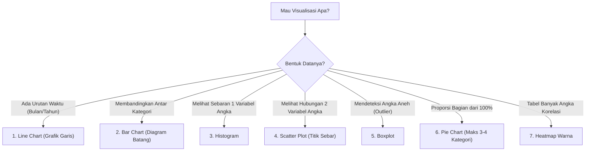

# BUKU PANDUAN PRAKTIKUM DATA MINING
## MODUL 1: PENGENALAN DATA MINING DENGAN PYTHON
**Program Studi:** Sistem Informasi — Universitas Semarang (USM)  
**Penyusun:** Tim Asisten & Dosen Pengampu Data Mining  

---

## DAFTAR ISI
1. [BAB I: PENDAHULUAN & MINDSET DATA DETECTIVE](#bab-i-pendahuluan--mindset-data-detective)
2. [BAB II: PERSIAPAN LINGKUNGAN KERJA (ENVIRONMENT)](#bab-ii-persiapan-lingkungan-kerja-environment)
3. [BAB III: EKSPLORASI DATA TABULAR DENGAN PANDAS](#bab-iii-eksplorasi-data-tabular-dengan-pandas)
4. [BAB IV: MEMBEDAH STATISTIK DESKRIPTIF TANPA RUMUS RUMIT](#bab-iv-membedah-statistik-deskriptif-tanpa-rumus-rumit)
5. [BAB V: VISUAL STORYTELLING (VISUALISASI DATA)](#bab-v-visual-storytelling-visualisasi-data)
6. [BAB VI: STUDI KASUS & PEMBAHASAN TUGAS PRAKTIKUM](#bab-vi-studi-kasus--pembahasan-tugas-praktikum)
7. [BAB VII: PANDUAN INSTRUKTUR / ASISTEN (MENGAJAR EFEKTIF 50 MENIT)](#bab-vii-panduan-instruktur--asisten-mengajar-efektif-50-menit)
8. [BAB VIII: TROUBLESHOOTING ERROR UMUM PEMULA](#bab-viii-troubleshooting-error-umum-pemula)

---

## BAB I: PENDAHULUAN & MINDSET "DATA DETECTIVE"

### 1.1 Apa Sebenarnya Data Mining Itu?
Bayangkan Anda adalah seorang detektif yang masuk ke gudang arsip berisi jutaan kuitansi toko kelontong. Jika kuitansi itu hanya ditumpuk, itu hanyalah **data mentah sampah**. Tetapi jika Anda mengurainya dan menemukan bahwa:
> *"Setiap hari Jumat sore jam 17.00–19.00, para bapak muda yang membeli popok bayi 80% juga membeli minuman kopi kaleng,"*

Maka Anda baru saja menemukan **informasi berharga (knowledge discovery)**! Pemilik toko bisa langsung memindahkan rak kopi kaleng persis di sebelah rak popok untuk melipatgandakan omset.

Inilah inti **Data Mining**: proses menggali pola tersembunyi, tren rahasia, dan anomali dari tumpukan data besar menggunakan perpaduan matematika, statistik, dan pemrograman komputer.

### 1.2 Mengapa Pakai Python? Kenapa Bukan Excel Saja?
| Kebutuhan | Microsoft Excel | Python (Pandas & NumPy) |
| :--- | :--- | :--- |
| **Batas Data** | Maksimal 1.048.576 baris (langsung lemot/crash). | Jutaan hingga miliaran baris tanpa kendala. |
| **Otomasi** | Harus klik tombol & rumus manual tiap minggu. | Cukup 1 kali tulis script, bisa dijadwalkan otomatis jalan tiap jam/hari. |
| **Kesiapan AI/ML** | Sangat terbatas untuk Machine Learning modern. | Standar emas dunia untuk AI, Deep Learning, dan Data Mining. |
| **Biaya Lisensi** | Berbayar (Microsoft Office). | 100% Gratis & Open-Source. |

---

## BAB II: PERSIAPAN LINGKUNGAN KERJA (ENVIRONMENT)

Sebelum memotong bahan masakan di dapur, seorang koki wajib memastikan wajan, pisau, dan kompor sudah siap. Di dunia data science, alat-alat tersebut disebut **Library**.

### 2.1 Panca-Indera Library Data Science
1. **NumPy (`numpy`)**: Otak komputasi matematika kilat. Mengolah matriks dan array angka berkecepatan tinggi.
2. **Pandas (`pandas`)**: Jantung manipulasi data tabular. Mengubah data mentah menjadi bentuk tabel mirip Excel yang fleksibel.
3. **Matplotlib (`matplotlib`)**: Alat gambar diagram dasar 2D (garis, batang, lingkaran).
4. **Seaborn (`seaborn`)**: Alat visualisasi statistik tingkat lanjut berbasis Matplotlib dengan tampilan warna modern dan estetis.
5. **SciPy (`scipy`)**: Pustaka komputasi ilmiah untuk uji hipotesis dan rumus statistika lanjutan.

### 2.2 Cara Instalasi & Verifikasi Mandiri
Buka Command Prompt (Windows) atau Terminal (Linux/macOS), lalu jalankan perintah instalasi berikut:
```bash
pip install numpy pandas matplotlib seaborn scipy jupyter
```

Untuk memverifikasi apakah seluruh pustaka sudah terpasang sempurna, jalankan skrip [1_2_verifikasi_library.py](file:///d:/_PEKERJAAN/PRAKTIKUM%20DATA%20MINING/praktikum1/1_2_verifikasi_library.py):
```python
import numpy, pandas, matplotlib, seaborn, scipy
print("Semua library berhasil diinstal dan siap digunakan!")
```
Jika terminal menampilkan tulisan tersebut tanpa pesan warna merah (*Error*), environment Anda 100% siap.

---

## BAB III: EKSPLORASI DATA TABULAR DENGAN PANDAS

### 3.1 Mengenal DataFrame (Sub-bab 2.1)
File: [2_1_membuat_dataframe.py](file:///d:/_PEKERJAAN/PRAKTIKUM%20DATA%20MINING/praktikum1/2_1_membuat_dataframe.py)

DataFrame adalah tabel dua dimensi yang terdiri atas **Baris (Index)** dan **Kolom (Series)**.
```python
import pandas as pd

data = {
    "Nama"   : ["Andi", "Budi", "Citra", "Dewi", "Eko", "Fajar", "Gita"],
    "JK"     : ["L", "L", "P", "P", "L", "L", "P"],
    "Usia"   : [19, 20, 18, 21, 20, 19, 20],
    "UTS"    : [78, 85, 92, 60, 70, 88, 75],
    "UAS"    : [80, 88, 95, 65, 72, 84, 90]
}

df = pd.DataFrame(data)
print(df)
```

**Penjelasan Baris Demi Baris:**
* `data = { ... }`: Dictionary Python tempat menyimpan data mentah. Kunci (key) seperti `"Nama"`, `"JK"` akan otomatis menjadi nama kolom tabel.
* `pd.DataFrame(data)`: Perintah sakti Pandas yang mengubah kamus acak menjadi tabel beraturan.
* `df`: Singkatan umum untuk DataFrame yang disepakati oleh seluruh data scientist dunia.

---

### 3.2 Tiga Mantra "Rontgen" Data (Sub-bab 2.2)
File: [2_2_melihat_ringkasan_data.py](file:///d:/_PEKERJAAN/PRAKTIKUM%20DATA%20MINING/praktikum1/2_2_melihat_ringkasan_data.py)

Seorang dokter tidak akan langsung mengoperasi pasien sebelum melakukan foto Rontgen. Data Analyst pun wajib merontgen data sebelum mengutak-atiknya:

#### 1. `df.head(3)` — Mengintip Kepala Data
* **Fungsi:** Menampilkan 3 baris data paling atas.
* **Tujuan:** Memastikan data ter-load dengan benar, nama kolom tidak geser, dan sampel baris pertama terbaca wajar. Kalau datanya ada 500.000 baris, mengetik `print(df)` akan membuat komputer macet; `head()` menyelamatkan layar Anda.

#### 2. `df.info()` — Memeriksa Kesehatan & Tipe Data
Output `df.info()` menampilkan:
* **RangeIndex:** Jumlah total baris yang ada.
* **Non-Null Count:** Jumlah data yang tidak kosong. Jika total baris ada 7, tapi baris Non-Null hanya 5, berarti ada **2 data bolong (Missing Value)** yang harus ditangani!
* **Dtype (Data Type):**
  * `int64` / `float64`: Angka murni yang bisa dihitung matematikanya.
  * `object`: Teks/string atau kategori.

#### 3. `df.describe()` — Rangkuman Statistik Kilat Otomatis
Hanya dengan 1 perintah, Pandas menghitung 8 metrik statistik sekaligus untuk seluruh kolom angka:
* `count`: Jumlah baris yang terisi angka.
* `mean`: Rata-rata nilai.
* `std`: Simpangan baku (sebaran data).
* `min`: Nilai terendah.
* `25%` (Q1): Batas nilai kuartil bawah.
* `50%`: Nilai median (nilai tengah).
* `75%` (Q3): Batas nilai kuartil atas.
* `max`: Nilai tertinggi.

---

## BAB IV: MEMBEDAH STATISTIK DESKRIPTIF TANPA RUMUS RUMIT

Statistik deskriptif bukan bertujuan membuat kepala pusing dengan rumus sigma, melainkan **mencari cerita di balik angka**.

### 4.1 Ukuran Pemusatan: Mean vs Median (Sub-bab 2.3)
File: [2_3_ukuran_pemusatan_data.py](file:///d:/_PEKERJAAN/PRAKTIKUM%20DATA%20MINING/praktikum1/2_3_ukuran_pemusatan_data.py)

#### Analogi Sederhana: "Sultan Masuk Warkop"
Bayangkan ada 5 mahasiswa di warkop kampus dengan uang saku:
`[10.000, 10.000, 12.000, 15.000, 18.000]`
* Rata-rata (Mean) = Rp 13.000
* Nilai Tengah (Median) = Rp 12.000
*(Keduanya mirip dan akurat menggambarkan kondisi anak kos).*

Lalu tiba-tiba seorang Sultan masuk warkop membawa uang tunai **Rp 1.000.000.000 (1 Miliar)**.
Data baru: `[10.000, 10.000, 12.000, 15.000, 18.000, 1.000.000.000]`
* Rata-rata (Mean) baru = **Rp 166.677.500 per orang!** (Apakah mahasiswa itu mendadak kaya? Tidak! Rata-rata tertipu oleh si Sultan).
* Nilai Tengah (Median) baru = **Rp 13.500 per orang.** (Tetap waras dan mencerminkan realita).

> **Pelajaran Emas Data Analyst:**  
> Jika data Anda punya angka ekstrem yang jomplang (*Outlier*), **gunakan MEDIAN**, bukan MEAN! Inilah alasan HRD selalu memakai Median saat menentukan standar gaji industri.

---

### 4.2 Ukuran Penyebaran: Simpangan Baku / Standard Deviation (Sub-bab 2.4)
File: [2_4_ukuran_penyebaran_data.py](file:///d:/_PEKERJAAN/PRAKTIKUM%20DATA%20MINING/praktikum1/2_4_ukuran_penyebaran_data.py)

Simpangan baku (`df['UTS'].std()`) mengukur **kekompakan / keseragaman kelompok**:
* **Nilai STD Rendah (Mendekati 0):** Nilai semua orang mirip-mirip, data sangat kompak dan stabil.
* **Nilai STD Tinggi:** Nilai mencar-mencar berantakan. Ada yang jenius sekali (98) dan ada yang anjlok sekali (20).

**Contoh Industri:**
Di pabrik minuman Coca-Cola/Aqua, mesin pengisi botol harus punya STD mendekati 0. Jika STD-nya tinggi, berarti ada botol yang isinya luber dan ada botol yang isinya setengah kosong!

---

### 4.3 Mengukur Hubungan Dua Hal: Korelasi (Sub-bab 2.5)
File: [2_5_korelasi_antar_variabel.py](file:///d:/_PEKERJAAN/PRAKTIKUM%20DATA%20MINING/praktikum1/2_5_korelasi_antar_variabel.py)

Korelasi menguji apakah dua hal di dunia ini saling memengaruhi. Skalanya selalu di antara **-1.0 sampai +1.0**:
```
-1.0 ------------------------ 0.0 ------------------------ +1.0
Negatif Kuat             Tidak Ada Hubungan            Positif Kuat
(Saling Berlawanan)                                     (Searah Kompak)
```
* **Korelasi Positif (+0.7 sampai +1.0):** Searah. Contoh: Jam belajar dengan nilai ujian. Jam belajar naik, nilai ujian ikut naik.
* **Korelasi Negatif (-0.7 sampai -1.0):** Terbalik. Contoh: Jumlah jam main game larut malam dengan IPK. Main game naik, IPK turun.
* **Mendekati 0.0:** Tidak ada korelasi. Contoh: Ukuran sepatu mahasiswa dengan nilai kalkulus.

---

### 4.4 Filter dan GroupBy (Sub-bab 2.6)
File: [2_6_seleksi_dan_filter_data.py](file:///d:/_PEKERJAAN/PRAKTIKUM%20DATA%20MINING/praktikum1/2_6_seleksi_dan_filter_data.py)

* **Filter Baris:** `mahasiswa_lulus = df[df["UTS"] >= 75]`  
  Sistem hanya menyaring mahasiswa yang memenuhi syarat lulus.
* **GroupBy:** `df.groupby("JK")["UAS"].mean()`  
  Sistem secara otomatis mengelompokkan mahasiswa berdasarkan jenis kelamin (L vs P), lalu langsung menghitung rata-rata nilai UAS masing-masing kubu.

---

## BAB V: VISUAL STORYTELLING (VISUALISASI DATA)

Angka di tabel membuat orang mengantuk; gambar visual membuat orang langsung paham dalam 3 detik.

### 5.1 Kapan Harus Menggunakan Jenis Grafik Tertentu?



### 5.2 Bedah 7 Grafik Utama Praktikum:

1. **Line Chart ([3_1_grafik_garis.py](file:///d:/_PEKERJAAN/PRAKTIKUM%20DATA%20MINING/praktikum1/3_1_grafik_garis.py)):**  
   Paling cocok untuk melihat tren omset penjualan bulanan dari Januari hingga Juli.
2. **Bar Chart ([3_2_diagram_batang.py](file:///d:/_PEKERJAAN/PRAKTIKUM%20DATA%20MINING/praktikum1/3_2_diagram_batang.py)):**  
   Adu tinggi tiang. Membandingkan rata-rata nilai UAS antara mahasiswa Laki-laki vs Perempuan.
3. **Histogram ([3_3_histogram.py](file:///d:/_PEKERJAAN/PRAKTIKUM%20DATA%20MINING/praktikum1/3_3_histogram.py)):**  
   Membagi angka ke dalam keranjang (`bins=5`). Menunjukkan di rentang nilai berapa mahasiswa paling banyak menumpuk.
4. **Scatter Plot ([3_4_scatter_plot.py](file:///d:/_PEKERJAAN/PRAKTIKUM%20DATA%20MINING/praktikum1/3_4_scatter_plot.py)):**  
   Menembakkan titik koordinat UTS vs UAS. Jika titik-titik membentuk pola diagonal naik ke kanan atas, membuktikan hubungan positif.
5. **Boxplot ([3_5_boxplot.py](file:///d:/_PEKERJAAN/PRAKTIKUM%20DATA%20MINING/praktikum1/3_5_boxplot.py)):**  
   Kotak detektif angka anomali. Kotak menunjukkan 50% data normal, kumis menunjukkan batas toleransi wajar, dan titik di luar kumis adalah **Pencilan/Outlier**.
6. **Pie Chart ([3_6_pie_chart.py](file:///d:/_PEKERJAAN/PRAKTIKUM%20DATA%20MINING/praktikum1/3_6_pie_chart.py)):**  
   Potongan pizza proporsi 100%. Cocok untuk membandingkan persentase gender mahasiswa kelas.
7. **Heatmap ([3_7_heatmap_korelasi.py](file:///d:/_PEKERJAAN/PRAKTIKUM%20DATA%20MINING/praktikum1/3_7_heatmap_korelasi.py)):**  
   Tabel korelasi dengan warna pintar. Mata manusia tidak perlu membaca angka koma kecil, cukup melirik kotak merah yang menyala terang.

### 5.3 Menyimpan Gambar Berkualitas Tinggi ([3_8_menyimpan_gambar.py](file:///d:/_PEKERJAAN/PRAKTIKUM%20DATA%20MINING/praktikum1/3_8_menyimpan_gambar.py))
```python
plt.savefig("histogram_uas.png", dpi=150, bbox_inches="tight")
```
* `dpi=150`: Dots Per Inch. Menghasilkan gambar tajam beresolusi tinggi yang tidak pecah saat disematkan di Word atau dicetak di skripsi/laporan.
* `bbox_inches="tight"`: Memotong spasi kosong di pinggir gambar agar grafik pas dan rapi.

---

## BAB VI: STUDI KASUS & PEMBAHASAN TUGAS PRAKTIKUM

File Implementasi: [tugas_praktikum1.py](file:///d:/_PEKERJAAN/PRAKTIKUM%20DATA%20MINING/praktikum1/tugas_praktikum1.py)

### 6.1 Soal Studi Kasus:
Buatlah data 10 mahasiswa dengan kolom: `Nama, JK, Usia, UTS, UAS, Absensi`. Lakukan analisis statistik lengkap, uji korelasi antara Absensi dan UAS, lalu buat serta simpan 5 visualisasi ke file gambar!

### 6.2 Data 10 Mahasiswa:
```python
data_tugas = {
    "Nama": ["Andi", "Budi", "Citra", "Dewi", "Eko", "Fajar", "Gita", "Hadi", "Indah", "Joko"],
    "JK": ["L", "L", "P", "P", "L", "L", "P", "L", "P", "L"],
    "Usia": [19, 20, 18, 21, 20, 19, 20, 22, 19, 21],
    "UTS": [78, 85, 92, 60, 70, 88, 75, 82, 90, 65],
    "UAS": [80, 88, 95, 65, 72, 84, 90, 85, 92, 70],
    "Absensi": [85, 90, 95, 70, 75, 90, 85, 88, 95, 72]
}
```

### 6.3 Temuan Analisis:
1. **Rata-rata Nilai:** UTS rata-rata 78.50, UAS rata-rata 82.10.
2. **Korelasi Absensi vs UAS:** Ditemukan angka **0.9519** (Sangat Mendekati +1.0).
   * **Kesimpulan Ilmiah:** Mahasiswa yang rajin hadir di kelas terbukti memiliki performa nilai ujian akhir yang sangat tinggi. Kehadiran merupakan faktor penentu utama kesuksesan akademik.
3. **5 File Gambar Hasil Tugas:**
   * [tugas_1_histogram_uts.png](file:///d:/_PEKERJAAN/PRAKTIKUM%20DATA%20MINING/praktikum1/tugas_1_histogram_uts.png)
   * [tugas_2_boxplot_uas.png](file:///d:/_PEKERJAAN/PRAKTIKUM%20DATA%20MINING/praktikum1/tugas_2_boxplot_uas.png)
   * [tugas_3_scatter_uts_uas.png](file:///d:/_PEKERJAAN/PRAKTIKUM%20DATA%20MINING/praktikum1/tugas_3_scatter_uts_uas.png)
   * [tugas_4_barchart_uas_jk.png](file:///d:/_PEKERJAAN/PRAKTIKUM%20DATA%20MINING/praktikum1/tugas_4_barchart_uas_jk.png)
   * [tugas_5_heatmap_korelasi.png](file:///d:/_PEKERJAAN/PRAKTIKUM%20DATA%20MINING/praktikum1/tugas_5_heatmap_korelasi.png)

---

## BAB VII: PANDUAN INSTRUKTUR / ASISTEN (MENGAJAR EFEKTIF 50 MENIT)

Jika waktu praktikum terbatas hanya 50 menit:

### 1. Manajemen Waktu 50 Menit
* **Menit 00–05:** Buka dengan cerita: "Kenapa Excel kalah sama Python?" (Bangkitkan rasa penasaran).
* **Menit 05–15:** Buka [praktikum1.ipynb](file:///d:/_PEKERJAAN/PRAKTIKUM%20DATA%20MINING/praktikum1/praktikum1.ipynb), run bagian `info()` dan `describe()`. Tunjukkan cara mendeteksi data yang bolong.
* **Menit 15–30:** Jelaskan cerita "Sultan Masuk Warkop" untuk membedakan Mean vs Median. Lalu jelaskan Korelasi.
* **Menit 30–45:** Jalankan grafik: Tunjukkan Histogram, Boxplot, dan Heatmap warna.
* **Menit 45–50:** Berikan instruksi pengerjaan [tugas_praktikum1.py](file:///d:/_PEKERJAAN/PRAKTIKUM%20DATA%20MINING/praktikum1/tugas_praktikum1.py) sebagai tugas mandiri/kelompok.

### 2. Tips Mengontrol Kelas
* Jangan biarkan mahasiswa menghabiskan 30 menit mengetik sintaks dari nol di Command Prompt! Gunakan file notebook starter yang sudah ada.
* Beri tantangan interaktif singkat: *"Coba kalian ubah nilai UTS Dewi jadi 100, perhatikan rata-ratanya berubah jadi berapa?"* Mahasiswa akan belajar aktif (*active learning*).

---

## BAB VIII: TROUBLESHOOTING ERROR UMUM PEMULA

Berikut kamus penyelamat saat mahasiswa panik di depan komputer laboratorium:

### 1. `ModuleNotFoundError: No module named 'matplotlib'`
* **Penyebab:** Library belum terpasang di Python yang sedang aktif.
* **Solusi:** Buka Command Prompt, ketik: `pip install matplotlib seaborn pandas numpy`

### 2. `KeyError: 'uts'`
* **Penyebab:** Python itu *case-sensitive* (membedakan huruf besar dan kecil). Kolom di data bernama `"UTS"`, tapi dipanggil `"uts"` (huruf kecil).
* **Solusi:** Samakan persis huruf besar/kecilnya menjadi `df["UTS"]`.

### 3. `SyntaxError: invalid syntax`
* **Penyebab:** Lupa menutup kurung `)`, tanda petik tidak berpasangan `"` atau koma `,` ketinggalan.
* **Solusi:** Cek baris kode yang ditunjuk tanda panah merah di pesan error.

### 4. Gambarnya tidak muncul di layar!
* **Penyebab:** Lupa menulis perintah penutup.
* **Solusi:** Pastikan di baris paling bawah kode visualisasi selalu diakhiri dengan:
  ```python
  plt.show()
  ```

---
*Selamat Belajar dan Mengeksplorasi Data Mining! Jadilah Detektif Data yang Handal.*
